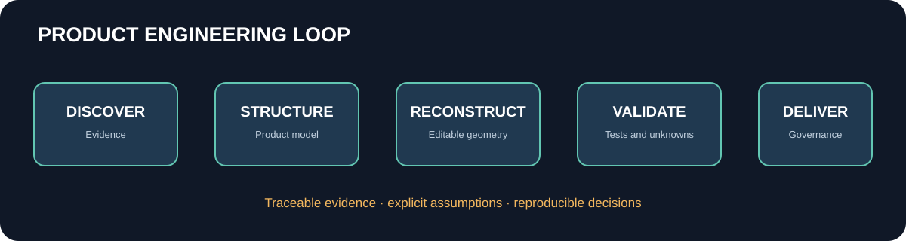
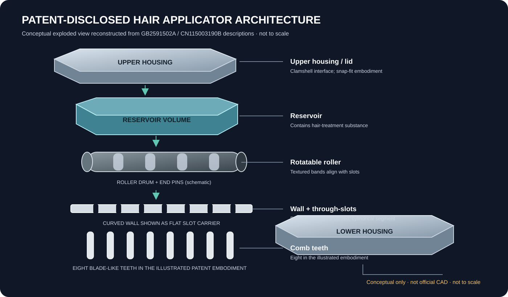

# Product Engineering Lab

### From product evidence to engineering intelligence.

Research · Reconstruction · Validation · Productisation

    

Product Engineering Lab investigates how fragmented product evidence can become structured, editable, traceable and testable engineering knowledge.

This is not simply a text-to-3D showcase. It explores the engineering layer around generative 3D: evidence provenance, component semantics, constraints, uncertainty, validation and governed decisions.

## Why Sand3D?

[Sand3D](https://github.com/Sandflow-ai/sand3d) is a reference for editable, programmatic 3D generation over Blender's Python API. This lab explores what additional structure makes generated geometry useful in product engineering: component identity, evidence-linked parameters, assembly relationships, constraints, validation and reproducibility.

Sand3D remains an independently maintained third-party project. We respect its own licence, notices and API boundaries and integrate through documented adapters rather than assuming ownership of its internals.

## Antirez reference projects: why they matter

The lab also studies selected small, inspectable computational-graphics and geometry projects by [Salvatore Sanfilippo (antirez)](https://github.com/antirez). These are not presented as a ready-made 3D engine or as replacements for Sand3D. They are focused reference implementations chosen because their source makes specific transformations and rendering techniques easier to inspect, test and learn from.

| Upstream project | Why it is relevant to this lab | Intended research use |
|---|---|---|
| [jsrt](https://github.com/antirez/jsrt) | A deliberately small JavaScript ray tracer. Its limited scene primitives make the rendering pipeline approachable rather than hiding it behind a large graphics framework. | Study ray/primitive intersection, camera rays, shading and the relationship between scene data and rendered pixels. A possible minimal renderer reference for visual debugging and educational demonstrations. |
| [pngtostl](https://github.com/antirez/pngtostl) | Converts image luminance into variable-thickness lithophane geometry and exports STL. It is a concrete example of turning 2D pixel evidence into 3D printable geometry. | Study image sampling, intensity-to-height mapping, mesh construction, STL export, resolution trade-offs and manufacturability checks. This is especially relevant to evidence-to-geometry experiments. |
| [strabo](https://github.com/antirez/strabo) | Converts HGT digital-elevation data into 2D map products and 3D VRML models, including interpolation, projection, contour and terrain operations. | Study data-driven terrain reconstruction, coordinate transformations, interpolation, contour extraction and conversion of measured data into 3D representations. |

### Why keep these as separate reference projects?

Each project demonstrates a different part of the visual-engineering problem:

- **jsrt — rendering:** how geometry and camera/light calculations become an image.
- **pngtostl — 2D-to-3D conversion:** how image values become physical dimensions and a mesh.
- **strabo — measured-data reconstruction:** how geospatial samples become projected maps, contours and terrain surfaces.

Together they provide useful, bounded case studies for a future in-house computational core. The objective is to understand and evaluate the algorithms, document their limitations, and identify which concepts are worth reimplementing behind our own interfaces. They are not dependencies of the active Nyfasi reconstruction and do not imply that the lab has adopted or integrated their code.

### Forking, licensing and attribution

A fork is intended to preserve an upstream project’s history and provide a controlled place for experiments; it is not a claim of authorship or a licence to relicense the original work.

- **pngtostl:** upstream README identifies the BSD 2-Clause licence. Any fork or adaptation must retain the applicable copyright and licence notices.
- **strabo:** upstream README identifies a BSD licence; GitHub currently identifies the repository licence as BSD 3-Clause. Preserve the upstream notices and verify the exact licence text in the fork before redistribution.
- **jsrt:** no licence is currently declared in the repository metadata or README inspected for this research. Public visibility is not a reuse licence. Keep it as an upstream study reference unless the author adds a licence or grants permission; do not copy, modify or redistribute its code on the assumption that it is open source.

Forks and integrations must be recorded explicitly once created. Until then, the upstream repositories linked above are the source of truth. The lab will keep third-party code, notices and any local modifications clearly separated from original Product Engineering Lab work.

## Canonical Sand3D engineering stack

The Nyfasi reconstruction now uses [Sand3D](https://github.com/Sandflow-ai/sand3d) as its single canonical modelling and assembly engine. The Python program, parameter ledger, assembly hierarchy, joint metadata, GLB/URDF/USDA/OBJ/STL exports, benchmark and source-linked browser gallery form one reproducible path. The gallery follows the core interaction model of Sandflow's [official articulated gallery](https://sand3d.sandflow.ai/gallery.html): inspect the model beside its real source, select a part to trace its construction, and operate exported joints.

CadFlow work is retained as historical research and comparison material, but is no longer part of the active Nyfasi build or publication path. Sand3D does not currently replace CadFlow's OpenCascade B-rep and STEP capability; choosing one canonical stack is an explicit trade-off in favour of coherent program-to-assembly provenance and native articulated exports, not a claim that Sand3D provides STEP or manufacturing-grade B-rep validation. See the [architecture decision records](docs/decisions/index.md) for the rationale and migration boundary.

## Experiment 001: Nyfasi Deluxe Detangler

This independent case study investigates what can responsibly be reconstructed from public product evidence and patent publications. Cross-source evidence strongly supports that the GB2591502A patent family relates to Nyfasi's patented Deluxe Detangler, although the exact publication-to-retail-SKU/revision mapping remains unverified.

*Original explanatory diagram based on patent descriptions; not to scale and not official product CAD.*

The [China IP and manufacturing due-diligence dossier](docs/experiments/nyfasi-china-due-diligence.md) separates the Chinese patent grant from secondary-media reporting about mould manufacture and initial production. It does not claim to have identified a Chinese factory or supplier.

### Start here

- [Experiment 001 overview](experiments/001-nyfasi-reconstruction/README.md)
- [CAD parameter provenance and reconstruction boundary](docs/experiments/cad-parameter-provenance.md)
- [Patent reading notes](docs/experiments/patent-reading-notes.md)
- [China IP and manufacturing due diligence](docs/experiments/nyfasi-china-due-diligence.md)
- [Sand3D Colab notebook](experiments/001-nyfasi-reconstruction/notebooks/nyfasi_reconstruction_colab.ipynb)
- [Historical CadFlow B-rep Colab notebook](experiments/001-nyfasi-reconstruction/notebooks/nyfasi_cadflow_reconstruction_colab.ipynb)
- [Sand3D reconstruction script](experiments/001-nyfasi-reconstruction/scripts/build_reconstruction.py)
- [Historical CadFlow B-rep reconstruction script](experiments/001-nyfasi-reconstruction/scripts/build_cadflow_reconstruction.py)
- [Historical CadFlow reconstruction guide](docs/experiments/cadflow-reconstruction.md)
- [Sand3D demos, API and Hugging Face dataset strategy](docs/experiments/sand3d-dataset-strategy.md)
- [Historical CadFlow B-rep reconstruction and STEP exports](docs/experiments/cadflow-reconstruction.md)
- [Interactive assembly explorer](docs/experiments/assembly-explorer.md)
- [Interactive GLB viewer instructions](docs/experiments/viewer.md)
- [Image inventory](experiments/001-nyfasi-reconstruction/evidence/image-inventory.csv)
- [Patent figure register](experiments/001-nyfasi-reconstruction/evidence/patent-figure-register.csv)
- [Evidence source register](experiments/001-nyfasi-reconstruction/evidence/source-register.json)
- [Latest build record and output hashes](experiments/001-nyfasi-reconstruction/builds/2026-11-05.md)

[Open the documentation site](https://andiekobbietks.github.io/product-engineering-lab/) when GitHub Pages deployment is enabled. The [interactive assembly explorer](https://andiekobbietks.github.io/product-engineering-lab/experiments/assembly-explorer/) provides component inspection and local GLB loading.

The parameter ledger is the single source of truth for numeric CAD inputs. Each value is classified as patent-disclosed, patent-derived, measured, image-estimated, supplier-confirmed or an engineering assumption. The active reconstruction uses Sand3D as its single canonical modelling and assembly engine for procedural geometry, articulated exports and the source-linked browser gallery. CadFlow/OpenCascade scripts, reports and STEP/B-rep work remain historical research and are not part of the active build or publication path. The model includes a 180-degree curved wall proxy with seven interpreted arcuate slots, a concave roller seat, eight tooth proxies, raised annular roller bands, smooth lands, end walls, spindle pins, bearing supports, housing retention and a gasket proxy. The added details are parametric research geometry; most remain assumptions and are not validated against a retail sample. The geometry remains patent-led and unvalidated against a physical retail sample.

No original Nyfasi SolidWorks, Fusion 360, STEP or IGES files are claimed to have been located. Patent drawings are not native CAD.

## Engineering loop

1. Discover evidence, requirements and constraints.
2. Structure product, component and provenance records.
3. Reconstruct geometry with explicit assumptions.
4. Validate against independent evidence and measurable constraints.
5. Record decisions, unknowns, failures and approvals.
6. Carry reusable capabilities into production workflows.

## Platform direction

- **Product Engineering Lab:** experiments, benchmarks and reference implementations.
- **OKF:** portable, durable product knowledge.
- **AgentSON:** typed execution events, provenance and decision history.
- **AK Build:** reconciliation, validation, governance and productionisation.

The lab remains independently useful and provider-neutral.

## Commercial direction

The intended model is hybrid: potentially reusable public schemas and non-sensitive evaluation tools, alongside proprietary AK Build orchestration, integrations, managed validation workflows and engineering services. This is a business direction, not a current licence grant. The commercial proposal structure separates background IP, foreground deliverables, third-party materials and customer data.

## Status, licensing and rights

**Project-wide licence: undecided.** The previous MIT licence file was removed pending an IP and ownership review. See [LICENSING.md](LICENSING.md), the [IP register](docs/ip-register.md) and the [commercial proposal structure](docs/commercial-proposal.md).

This is independent research, not commissioned by, affiliated with or endorsed by Nyfasi, Dr Youmna Mouhamad, PDR, iF Design or Sandflow AI. Third-party images and text remain with their rights holders; the repository links to imagery rather than mirroring it without permission. Do not use illustrative geometry for manufacture or commercial replication without qualified engineering review and legal clearance.

See [methodology](docs/methodology.md), [architecture](docs/architecture.md), [roadmap](docs/roadmap.md) and [contributing](CONTRIBUTING.md).
