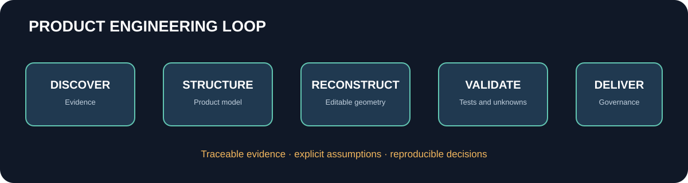
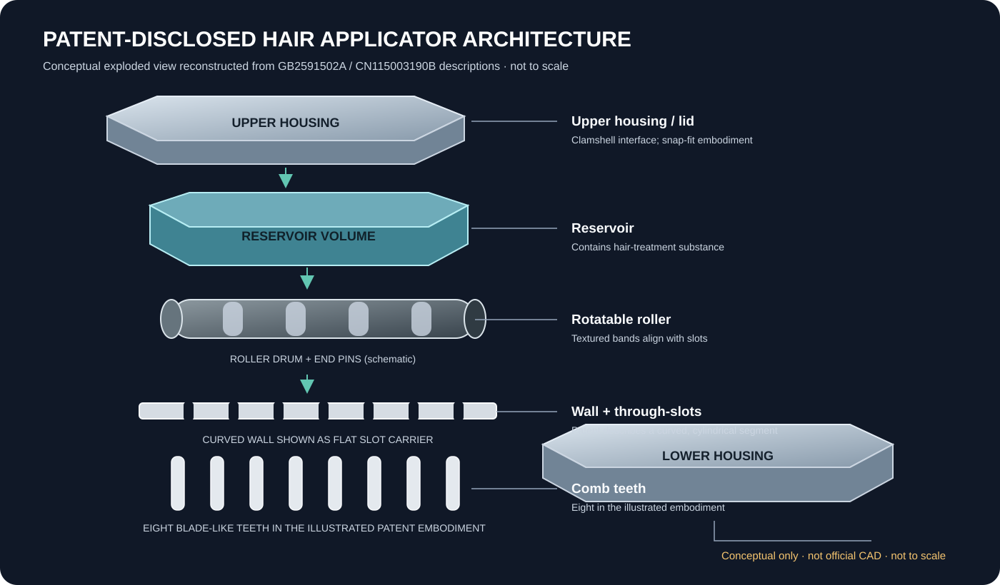

# Product Engineering Lab

### From product evidence to engineering intelligence.

Research · Reconstruction · Validation · Productisation

   

Product Engineering Lab investigates how fragmented product evidence can become structured, editable, traceable and testable engineering knowledge.

This is not simply a text-to-3D showcase. It explores the engineering layer around generative 3D: evidence provenance, component semantics, constraints, uncertainty, validation and governed decisions.

## Why Sand3D?

[Sand3D](https://github.com/Sandflow-ai/sand3d) is a reference for editable, programmatic 3D generation over Blender's Python API. This lab explores what additional structure makes generated geometry useful in product engineering: component identity, evidence-linked parameters, assembly relationships, constraints, validation and reproducibility.

Sand3D remains an independently maintained third-party project. We respect its own licence, notices and API boundaries and integrate through documented adapters rather than assuming ownership of its internals.

## Experiment 001: Nyfasi Deluxe Detangler

This independent case study investigates what can responsibly be reconstructed from public product evidence and patent publications. Cross-source evidence strongly supports that the GB2591502A patent family relates to Nyfasi's patented Deluxe Detangler, although the exact publication-to-retail-SKU/revision mapping remains unverified.

*Original explanatory diagram based on patent descriptions; not to scale and not official product CAD.*

The [China IP and manufacturing due-diligence dossier](docs/experiments/nyfasi-china-due-diligence.md) separates the Chinese patent grant from secondary-media reporting about mould manufacture and initial production. It does not claim to have identified a Chinese factory or supplier.

### Start here

- [Experiment 001 overview](experiments/001-nyfasi-reconstruction/README.md)
- [CAD parameter provenance and reconstruction boundary](docs/experiments/cad-parameter-provenance.md)
- [Patent reading notes](docs/experiments/patent-reading-notes.md)
- [China IP and manufacturing due diligence](docs/experiments/nyfasi-china-due-diligence.md)
- [Colab notebook](experiments/001-nyfasi-reconstruction/notebooks/nyfasi_reconstruction_colab.ipynb)
- [Sand3D reconstruction script](experiments/001-nyfasi-reconstruction/scripts/build_reconstruction.py)
- [Interactive GLB viewer instructions](docs/experiments/viewer.md)
- [Image inventory](experiments/001-nyfasi-reconstruction/evidence/image-inventory.csv)
- [Patent figure register](experiments/001-nyfasi-reconstruction/evidence/patent-figure-register.csv)
- [Evidence source register](experiments/001-nyfasi-reconstruction/evidence/source-register.json)
- [Latest build record and output hashes](experiments/001-nyfasi-reconstruction/builds/2026-11-05.md)

The parameter ledger is the single source of truth for numeric CAD inputs. Each value is classified as patent-disclosed, patent-derived, measured, image-estimated, supplier-confirmed or an engineering assumption. The current geometry uses a flat slotted wall proxy rather than the patent's curved wall and arcuate slots.

No original Nyfasi SolidWorks, Fusion 360, STEP or IGES files are claimed to have been located. Patent drawings are not native CAD.

## Engineering loop

1. Discover evidence, requirements and constraints.
2. Structure product, component and provenance records.
3. Reconstruct geometry with explicit assumptions.
4. Validate against independent evidence and measurable constraints.
5. Record decisions, unknowns, failures and approvals.
6. Carry reusable capabilities into production workflows.

## Platform direction

- **Product Engineering Lab:** experiments, benchmarks and reference implementations.
- **OKF:** portable, durable product knowledge.
- **AgentSON:** typed execution events, provenance and decision history.
- **AK Build:** reconciliation, validation, governance and productionisation.

The lab remains independently useful and provider-neutral.

## Commercial direction

The intended model is hybrid: potentially reusable public schemas and non-sensitive evaluation tools, alongside proprietary AK Build orchestration, integrations, managed validation workflows and engineering services. This is a business direction, not a current licence grant. The commercial proposal structure separates background IP, foreground deliverables, third-party materials and customer data.

## Status, licensing and rights

**Project-wide licence: undecided.** The previous MIT licence file was removed pending an IP and ownership review. See [LICENSING.md](LICENSING.md), the [IP register](docs/ip-register.md) and the [commercial proposal structure](docs/commercial-proposal.md).

This is independent research, not commissioned by, affiliated with or endorsed by Nyfasi, Dr Youmna Mouhamad, PDR, iF Design or Sandflow AI. Third-party images and text remain with their rights holders; the repository links to imagery rather than mirroring it without permission. Do not use illustrative geometry for manufacture or commercial replication without qualified engineering review and legal clearance.

See [methodology](docs/methodology.md), [architecture](docs/architecture.md), [roadmap](docs/roadmap.md) and [contributing](CONTRIBUTING.md).
