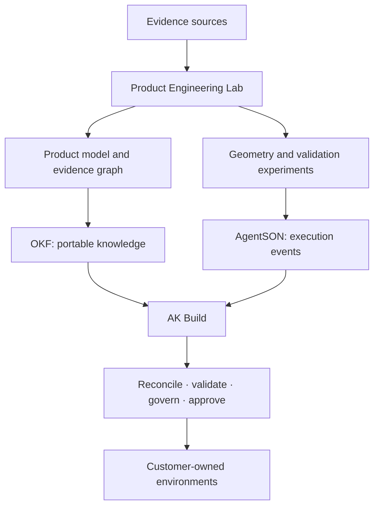

# Architecture

| Layer | Responsibility |
|---|---|
| Product Engineering Lab | Research, experiments, benchmarks and reference implementations |
| OKF | Durable, portable knowledge and relationships |
| AgentSON | Typed execution and coordination events |
| AK Build | Reconciliation, validation, governance and productionisation |

## Sand3D integration boundary

Sand3D is a reference project for editable 3D generation. Integrations should be isolated behind an adapter that records prompts, model/repository version, parameters, generated files and validation results. Do not assume undocumented APIs or make Sand3D a mandatory runtime dependency.

Principles: stable identifiers, explicit schema versions, open interchange formats, CAD/model adapters, human review, customer-owned data and reproducible runs.