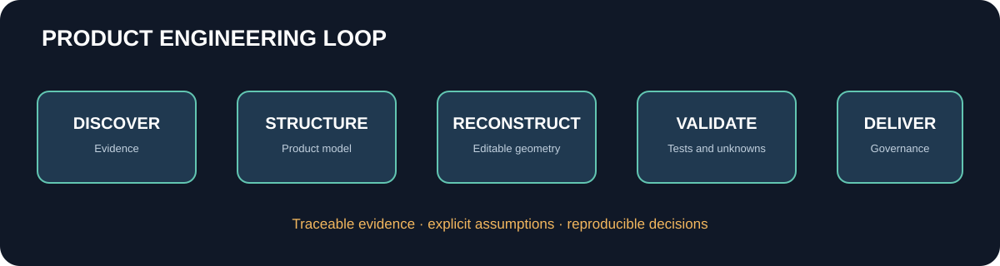

# Product Engineering Lab

An applied research environment for turning product evidence into traceable engineering models and decisions.

## Explore

- [Vision](vision.md), [methodology](methodology.md), [architecture](architecture.md) and [roadmap](roadmap.md).
- [Nyfasi independent research case study](experiments/nyfasi.md) and [validation protocol](experiments/nyfasi-validation.md).
- [IP and provenance register](ip-register.md), [commercial proposal structure](commercial-proposal.md) and [licensing status](../LICENSING.md).

## Current implementation

The repository contains an initial product model, JSON Schema, uncertainty register, Sand3D reconstruction script and Colab notebook. The model is an illustrative proxy with placeholder dimensions. It has not yet been rendered or validated against a measured product sample.

The project-wide licence remains undecided. See the licensing note before reusing any material.
